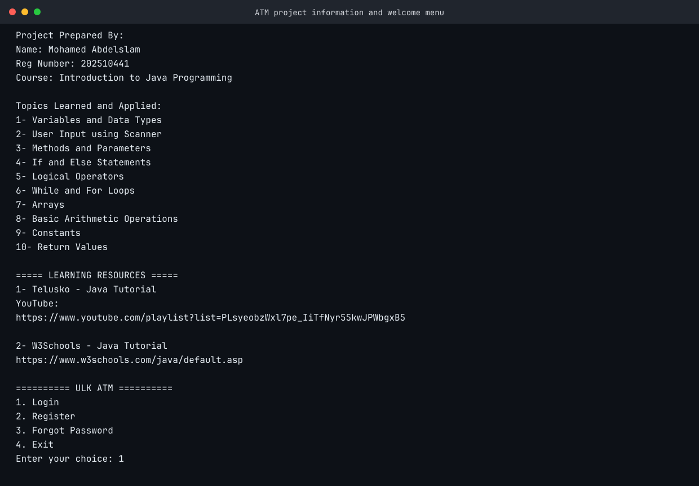
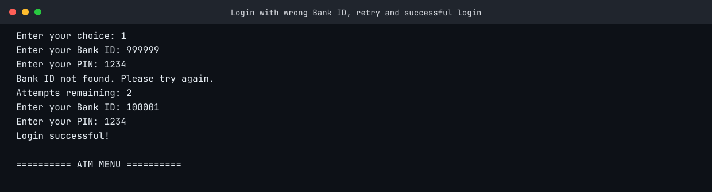
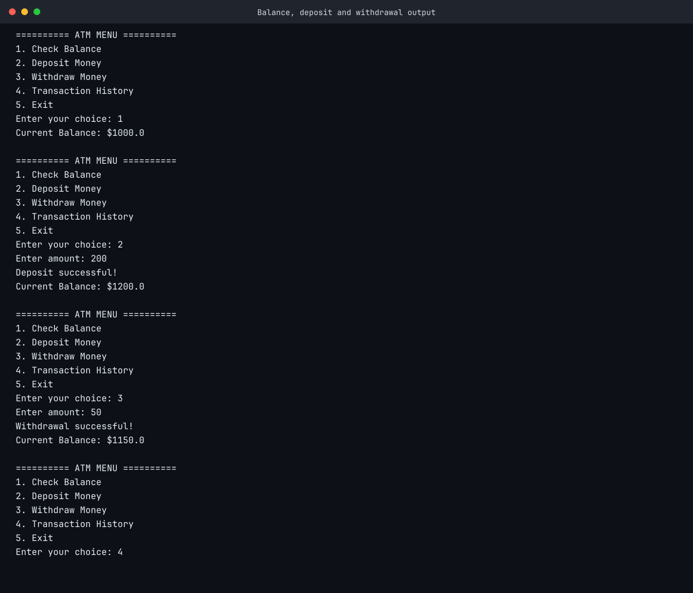
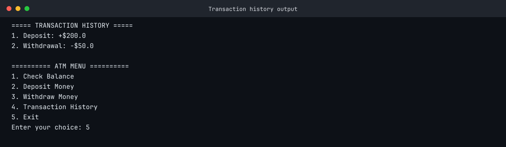
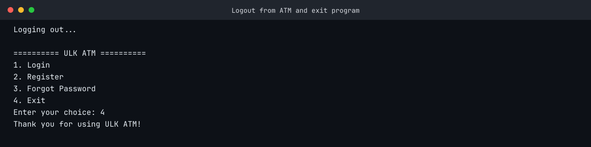
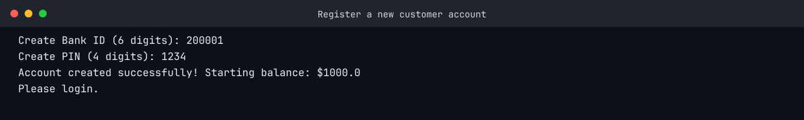
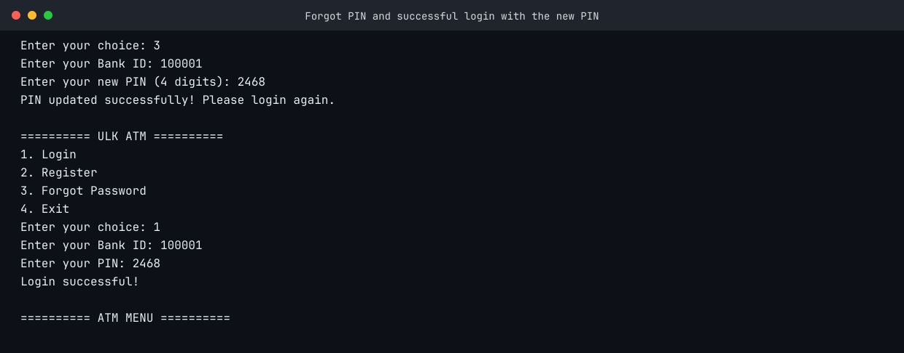
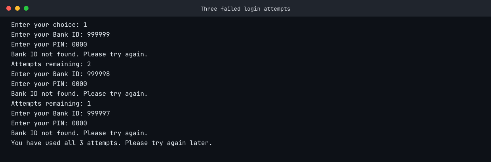

# ULK ATM Simulation

A small ATM program made with basic Java. It runs in the terminal and is made for learning and class demonstrations.

## What the program can do

- Log in with a Bank ID and PIN
- Register a new account
- Reset a PIN with the Bank ID
- Check the account balance
- Deposit and withdraw money
- Show the account's transaction history
- Try to log in up to three times

Each account starts with **$1000**. The program keeps account data while it is running. When you close the program, the data returns to its starting values.

## Run the program

Open a terminal in the folder that contains ATM.java, then type:

    javac ATM.java
    java ATM

You need the Java JDK installed so that the javac and java commands work.

## Sample accounts

These accounts are included so you can try the program:

| Bank ID | PIN |
|---|---|
| 100001 | 1234 |
| 100002 | 0000 |
| 100003 | 1111 |
| 100004 | 1212 |
| 100005 | 7777 |
| 100006 | 2222 |
| 100007 | 1122 |
| 100008 | 9999 |
| 100009 | 5555 |
| 100010 | 6969 |

They are demonstration accounts with simple PINs. Do not use these PINs for a real account.

## Screenshots of the program

The images below show each part of the program output.

### Project information and welcome menu

### Login and retry

### Balance, deposit, and withdrawal

### Transaction history

### Logout and exit

### New account registration

### Forgot PIN

### Three failed login attempts

## Java topics used

Variables, constants, methods, parameters, Scanner, if and else, logical operators, loops, arrays, and basic arithmetic.
